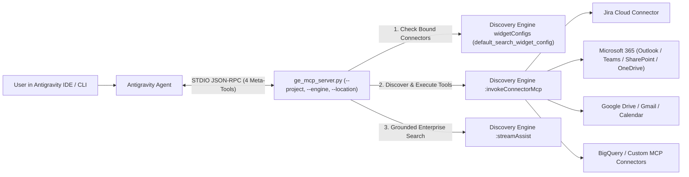

# Engine-Scoped Gemini Enterprise MCP Router for Antigravity (AGY)

A zero-dependency Python 3 Model Context Protocol (MCP) server (`ge_mcp_server.py`) that connects **Google Antigravity (AGY)** directly to all data connectors and search data stores bound to a specific **Gemini Enterprise (Agentspace / Discovery Engine)** instance.

---

## 1. Architecture Overview

Instead of registering a separate MCP server in `mcp_config.json` for every connector (or installing third-party `npm` packages that may be blocked by corporate proxies), Antigravity loads **one lightweight Python STDIO MCP server** (`gemini-enterprise`) bound to a single Gemini Enterprise Engine (`GE_MCP_ENGINE` / `--engine`).



> [!IMPORTANT]
> **Strict Engine-Level Isolation:** `ge_mcp_server.py` inspects the target engine's `default_search_widget_config` (`collectionComponents`) and `dataStoreIds` before listing or invoking any tool. Even if a GCP project hosts dozens of connectors across other Gemini Enterprise instances, **users can only see and invoke connectors attached to their configured `GE_MCP_ENGINE`**.

> [!NOTE]
> **Discovery Engine API Versions (`v1` vs `v1alpha`):**
> - **GA `v1` Endpoints Used:** Engine discovery/metadata (`GET /v1/.../engines/{id}`) and grounded enterprise search (`POST /v1/.../assistants/default_assistant:streamAssist`) use the General Availability **`v1`** API.
> - **`v1alpha`-Only Endpoints Used:** The Connector MCP bridge (`POST /v1alpha/.../dataConnector:invokeConnectorMcp`) and BAP action state metadata (`dataConnector` / `widgetConfigs`) are currently only exposed in **`v1alpha`** (calling `:invokeConnectorMcp` on `v1` or `v1beta` returns `HTTP 404`).

---

## 2. Repository Contents

| File | Description |
| :--- | :--- |
| [`ge_mcp_server.py`](./ge_mcp_server.py) | Zero-dependency Python 3 MCP server implementing the 4 engine-scoped meta-tools (`ge_list_connectors`, `ge_search_tools`, `ge_call_tool`, `ge_assist_query`). Dynamically locates `gcloud` across macOS and Linux paths. |
| [`install_ge_mcp.sh`](./install_ge_mcp.sh) | Automated installer script that detects `python3` and `gcloud`, discovers or validates `--engine` and its `--location`, installs `ge_mcp_server.py` into `$HOME/.gemini/config/`, safely merges `mcp_config.json`, and runs a live smoke test. |
| [`mcp_config.example.json`](./mcp_config.example.json) | Portable, OS-agnostic `mcp_config.json` template using `$HOME` runtime expansion (no hardcoded `/Users/...` or `/home/...` paths). |
| [`legacy_v1/ge_mcp_server.v1_backup.py`](./legacy_v1/ge_mcp_server.v1_backup.py) | Backup of the initial `v1` single-connector MCP server design. |

---

## 3. Prerequisites on the Target Machine

Before running the installer on a machine, verify:

1. **Python 3.9+** is installed (`python3 --version`).
2. **Google Cloud SDK (`gcloud`)** is installed and authenticated with the user's account:
   ```bash
   gcloud auth login
   ```
3. **IAM & Per-User Connector OAuth:**
   - The user has Discovery Engine access (`roles/discoveryengine.viewer` or `roles/discoveryengine.user`) on the GCP project.
   - For user-authenticated action connectors (such as **Jira**, **Microsoft Outlook / 365**, **Google Drive**, **Gmail**, **Google Calendar**), the user has clicked **Connect / Authorize** at least once under **Connected apps** in the Gemini Enterprise web app UI so their OAuth refresh token is stored (`authState: AUTHORIZED`).

---

## 4. Step-by-Step Deployment into an AGY Environment

### Option A: Automated 1-Command Setup (Recommended)

Clone this repository and run [`install_ge_mcp.sh`](./install_ge_mcp.sh):

```bash
git clone <REPO_URL> ~/Documents/antigravity/agy_ge_mcp
cd ~/Documents/antigravity/agy_ge_mcp

# Pass your Project, Engine ID, and the Engine's Location (e.g. global, us, or eu):
bash install_ge_mcp.sh \
  --project <YOUR_GCP_PROJECT_ID_OR_NUMBER> \
  --engine <YOUR_GEMINI_ENTERPRISE_ENGINE_ID> \
  --location <YOUR_ENGINE_LOCATION>
```

> [!TIP]
> **Auto-Discovery of Engine ID & Location:**
> - If you omit `--location`, `install_ge_mcp.sh` automatically queries Discovery Engine (`global`, `us`, `eu`) to detect which multi-region hosts your `--engine` and sets `GE_MCP_LOCATION` to match.
> - If you omit both `--engine` and `--location` (`bash install_ge_mcp.sh --project <YOUR_GCP_PROJECT_ID_OR_NUMBER>`), the installer scans all multi-regions (`global`, `us`, `eu`): if 1 engine exists, it selects both the Engine ID and its Location automatically; if multiple exist, it prints the exact `--engine <ID> --location <LOC>` flags for each instance so you can choose one.

---

### Option B: Manual Setup (100% Dynamic Paths)

1. **Copy the server script to `$HOME/.gemini/config/ge_mcp_server.py`:**
   ```bash
   mkdir -p "$HOME/.gemini/config"
   cp ge_mcp_server.py "$HOME/.gemini/config/ge_mcp_server.py"
   chmod +x "$HOME/.gemini/config/ge_mcp_server.py"
   ```

2. **Add the `"gemini-enterprise"` entry to `$HOME/.gemini/config/mcp_config.json` (and `$HOME/.gemini/antigravity/mcp_config.json`):**

   By invoking via `sh -c 'exec python3 "$HOME/.gemini/config/ge_mcp_server.py"'`, `$HOME` and `$PATH` are expanded dynamically at runtime regardless of OS (`macOS` `/Users/...`, `Linux` `/home/...`, or `Cloudtop` `/usr/local/google/home/...`):

   ```json
   {
     "mcpServers": {
       "gemini-enterprise": {
         "command": "sh",
         "args": [
           "-c",
           "PATH=\"$HOME/google-cloud-sdk/bin:/opt/homebrew/bin:/usr/local/bin:$PATH\" exec python3 \"$HOME/.gemini/config/ge_mcp_server.py\""
         ],
         "env": {
           "GE_MCP_PROJECT": "<YOUR_GCP_PROJECT_NUMBER_OR_ID>",
           "GE_MCP_ENGINE": "<YOUR_GEMINI_ENTERPRISE_ENGINE_ID>",
           "GE_MCP_LOCATION": "<YOUR_ENGINE_LOCATION>",
           "PYTHONUNBUFFERED": "1"
         }
       }
     }
   }
   ```

3. **Test the server from the terminal before reloading Antigravity:**
   ```bash
   python3 "$HOME/.gemini/config/ge_mcp_server.py" \
     --project="<YOUR_GCP_PROJECT_NUMBER_OR_ID>" \
     --engine="<YOUR_GEMINI_ENTERPRISE_ENGINE_ID>" \
     --location="<YOUR_ENGINE_LOCATION>" \
     --call-tool ge_list_connectors
   ```

4. **Reload or restart Antigravity** so it spawns the new `gemini-enterprise` MCP server.

---

## 5. What Needs to Be Updated for Another Environment?

Because `command` and `args` use runtime `$HOME` and `$PATH` expansion (and `ge_mcp_server.py` auto-discovers `gcloud` via `shutil.which("gcloud")` and `os.path.expanduser("~")`), **no filesystem paths need to be edited**. Only the **3 environment variables** in `env` change per Gemini Enterprise environment:

| Environment Variable in `mcp_config.json` | Required | Description | How to Find It |
| :--- | :--- | :--- | :--- |
| `GE_MCP_PROJECT` | **Yes** | Target GCP Project Number (preferred) or Project ID | Run `gcloud projects describe <PROJECT_ID> --format="value(projectNumber)"` |
| `GE_MCP_ENGINE` | **Yes** | Target Gemini Enterprise App / Engine ID | Found in **Google Cloud Console -> Agent Builder -> Apps**, or by running `bash install_ge_mcp.sh --project <PROJECT>` |
| `GE_MCP_LOCATION` | **Yes** *(must match engine location)* | Multi-region where `GE_MCP_ENGINE` is deployed (`global`, `us`, or `eu`). Dictated by the Gemini Enterprise instance's location. | Check the **Location** column for the app in **Agent Builder -> Apps**, or let `install_ge_mcp.sh` auto-detect it |

---

## 6. How to Use the MCP Server & How the 4 Meta-Tools Work

You do **not** need to name the meta-tools in your chat prompts—just ask natural-language questions (e.g., *"Create a Jira ticket..."* or *"Check my Outlook inbox..."*). Antigravity automatically orchestrates the 4 meta-tools behind the scenes:

1. **`ge_list_connectors`**
   - **Purpose:** Lists all action connectors and search data stores bound to the configured `GE_MCP_ENGINE`, along with each connector's `authState` (`AUTHORIZED` vs `UNKNOWN`) and its enabled actions/entities.
   - **When used:** Called first when you ask what integrations are available or when the agent needs to identify which connector handles a domain (e.g. Jira vs Outlook vs Drive).

2. **`ge_search_tools`**
   - **Purpose:** Queries `:invokeConnectorMcp` (`method: "tools/list"`) across bound connectors (caching schemas in memory for fast subsequent lookups) and searches tool names, descriptions, and input parameter schemas by `keyword` or `connector`.
   - **When used:** Called automatically when the agent knows the domain (e.g., `keyword="issue"` or `keyword="mail"` or `keyword="calendar"`) and needs the exact tool name and required JSON arguments.

3. **`ge_call_tool`**
   - **Purpose:** Executes a specific tool (`method: "tools/call"`) on a bound connector (`connector`, `tool_name`, `arguments`).
   - **Security Guardrail:** Verifies that `connector` is in the engine's allowlist before invoking `:invokeConnectorMcp`. Any attempt to call an unlinked project connector is rejected.

4. **`ge_assist_query`**
   - **Purpose:** Sends a natural-language query to the engine's `:streamAssist` endpoint to search unstructured knowledge across all bound data stores (SharePoint sites, OneDrive documents, Google Drive files, Confluence pages, GCS buckets).
   - **When used:** Called when you ask knowledge/retrieval questions rather than transactional action calls.

---

## 7. Sample Questions & Prompts by Connector

Below are sample prompts you and your teammates can ask directly in Antigravity once `gemini-enterprise` is loaded.

### A. Connector Discovery & Health Checks
- *"List all connectors available in my Gemini Enterprise instance and tell me which ones are authorized."*
- *"What tools are available on my Jira and Microsoft 365 connectors?"*
- *"Search my Gemini Enterprise tools for anything related to calendar events or email."*

### B. Jira Cloud Prompts
- **Browse Projects & Issues:**
  - *"List my Jira projects and show all open issues across them."*
  - *"Find all open High or Highest priority issues in project `<PROJECT_KEY>`."*
  - *"Search Jira using JQL for issues assigned to me that are still in 'To Do' or 'In Progress'."*
- **Create Issues / Tasks / Bugs:**
  - *"Create a new Task in Jira project `<PROJECT_KEY>` titled 'Set up CI/CD deployment pipeline' with Highest priority."*
  - *"Log a Bug in project `<PROJECT_KEY>` titled 'OAuth token refresh timeout on mobile' with High priority and description 'Users see a 401 error after 60 minutes of inactivity'."*
- **Update, Transition & Comment:**
  - *"Add a comment to Jira issue `<ISSUE_KEY>` saying 'Initial GitHub Actions workflow has been merged to main'."*
  - *"Update the priority of `<ISSUE_KEY>` to High and transition its status to 'In Progress'."*
  - *"Log 2 hours of work on issue `<ISSUE_KEY>` with the note 'Implemented staging deployment pipeline'."*

### C. Microsoft 365 — Outlook Mail Prompts
> *(Available when the Microsoft Outlook / Microsoft 365 connector is bound to your Gemini Enterprise Engine)*
- **Read & Triage Inbox:**
  - *"List my 10 most recent unread Outlook emails and summarize any urgent action items."*
  - *"Search my Outlook inbox for emails from `manager@company.com` about 'Q3 roadmap' from the last 14 days."*
  - *"Find the latest Outlook email thread with subject 'Customer Escalation - Acme Corp' and summarize the root cause discussed."*
- **Draft, Send & Reply:**
  - *"Send an Outlook email to `teammate@company.com` with subject 'Sprint 14 Status Update' and a bulleted list of all open issues in our Jira project."*
  - *"Create a draft reply in Outlook to the latest email about 'Security Audit' confirming that all high-priority items are tracked in Jira."*
  - *"Forward the latest email about 'Invoice #4821' to `finance@company.com` with a note asking for approval."*

### D. Microsoft 365 — Outlook Calendar & Teams Prompts
- **Calendar & Scheduling:**
  - *"What meetings are on my Outlook calendar for today and tomorrow?"*
  - *"Find a free 30-minute window on my Outlook calendar tomorrow afternoon between 1:00 PM and 5:00 PM."*
  - *"Schedule a 30-minute meeting on my Outlook calendar tomorrow at 2:00 PM EST titled 'CI/CD Pipeline Review' and invite `devops@company.com`."*
- **Microsoft Teams:**
  - *"List the Microsoft Teams and channels I belong to."*
  - *"Read the last 15 messages in the 'Engineering General' Teams channel and summarize what the team is working on."*
  - *"Post a message to our Teams deployment channel announcing that the CI/CD deployment pipeline ticket has been created and is in progress."*

### E. Microsoft 365 — SharePoint & OneDrive Prompts
- *"Search SharePoint and OneDrive for documents mentioning 'Cloud Migration Architecture' and summarize the key milestones."*
- *"Find the latest 'Quarterly Business Review' presentation in OneDrive or SharePoint."*
- *"What does our internal SharePoint policy say about production change management approvals?"* *(uses `ge_assist_query` for grounded enterprise search)*

### F. Google Workspace (Google Drive, Gmail, Google Calendar) Prompts
- *"Search my Google Drive for documents or spreadsheets containing 'Release Checklist'."*
- *"Check my Gmail for recent messages about 'deployment freeze' and summarize them."*
- *"List my upcoming Google Calendar events for the rest of this week."*

### G. Cross-Connector Multi-Step Workflows
Because all bound connectors sit behind the single `gemini-enterprise` MCP server, Antigravity can chain multiple connectors in a single prompt:
- **Outlook Email -> Jira Ticket -> Email Reply:**
  - *"Check my unread Outlook emails for any bug reports or escalations, create a corresponding Jira issue for each one, and reply to the sender with the new Jira ticket key."*
- **SharePoint / Drive Spec -> Jira Backlog:**
  - *"Search our enterprise documents for the 'Q4 Platform Reliability Spec', extract the action items, and create Jira tasks for them."*
- **BigQuery Metrics -> Jira / Outlook Report:**
  - *"Run a query on our BigQuery connector to check yesterday's failed job count, and if there are failures, create a High-priority Jira bug and email the summary via Outlook."*
